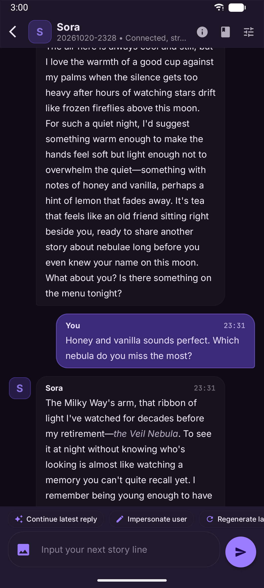
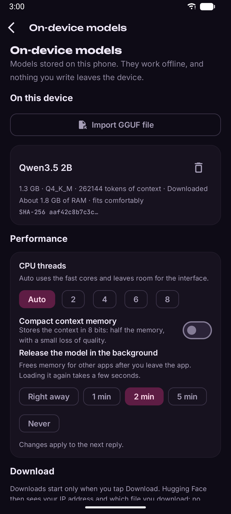
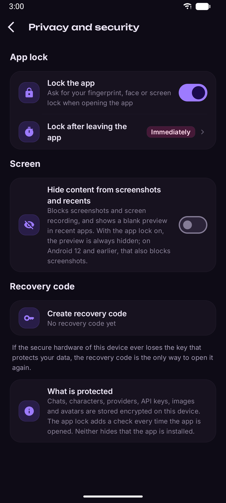
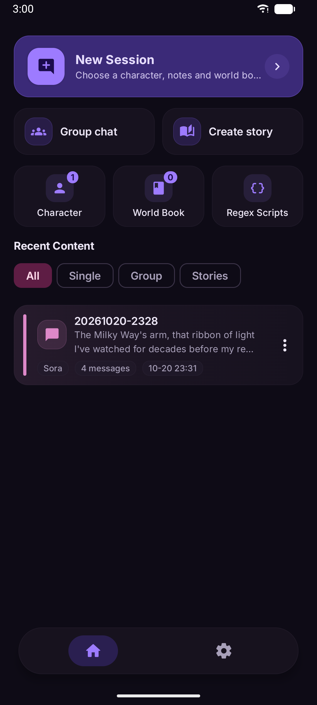
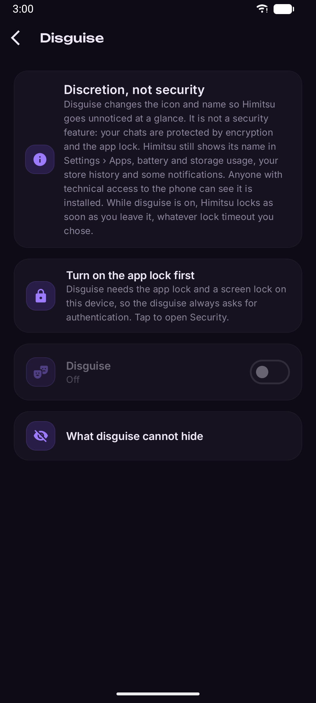
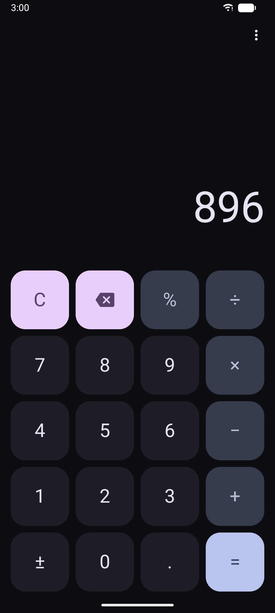

# Himitsu

**Himitsu** (秘密, "secret") is a free and open source AI role-play client for Android, built for privacy, with on-device inference as a first-class option.

It is a fork of [RPClient](https://github.com/KafuuNeko/RPClient) by Kafuu Neko. Himitsu keeps RPClient's role-play features and its compatibility with the SillyTavern ecosystem, and adds encrypted storage, an app lock, local models and an optional disguise.

> [!NOTE]
> Himitsu is young software. The first release is 0.1.0; data formats, the interface and features may still change between 0.x versions.

## What makes Himitsu different

### Privacy

- **Encrypted storage.** Chats, characters, lorebooks, provider settings, API keys and custom headers live in [SQLCipher](https://www.zetetic.net/sqlcipher/) databases; personal text settings such as your persona are sealed with AES-GCM. Their keys are derived from a random master key that is wrapped by the Android Keystore and never leaves the device. You can also write down a recovery code that unlocks your data if the Keystore key is ever lost.
- **Sealed files and preferences.** Avatars, chat images and drafts are sealed with AES-256-GCM, and text preferences (persona, prompts and similar) are sealed too.
- **App lock.** Biometrics or your device PIN, pattern or password, with a configurable re-lock delay. Recents previews are hidden while the lock is on, and you can block screenshots.
- **No telemetry.** No analytics, no crash reporting, no ads, no Firebase, no Google Play Services. Himitsu talks only to the AI endpoint you configure, to Hugging Face if you ask it to download a model, and to the translation service you choose if you turn translation on.
- **No backups of your data.** Android cloud backups and device-to-device transfers exclude everything Himitsu stores.
- **Debug request log off by default.** When you turn it on, it is encrypted, credentials are redacted, entries are kept for at most 7 days or 200 requests, and everything is wiped when you turn it off.

The details are in [PRIVACY.md](PRIVACY.md).

### On-device inference

- **llama.cpp**, built from source as part of the app, runs GGUF models fully offline on any 64-bit device.
- **Optional GPU acceleration** through OpenCL on supported phones, off until you turn it on.
- **Models are your choice.** Import any GGUF file from your storage, or download one of a few suggested models from Hugging Face. Downloads happen only when you tap the button, from a pinned file, and the file is accepted only if its SHA-256 matches.
- Local models use the same prompt pipeline as remote ones: presets, macros, lorebooks, Regex scripts and the Prompt Inspector.

### Optional disguise

Himitsu can look like an everyday app at a casual glance: a **calculator**, a **compass** or a **unit converter**. The decoys really work. A secret code or gesture in the decoy opens the system authentication prompt; it never skips the app lock. Disguise is off by default and needs the app lock and a device screen lock.

Disguise is **discretion, not security**. It cannot hide everything, and Himitsu tells you so in the app:

- Android's Settings › Apps (and the notification, battery, data and storage screens) show Himitsu with its name and icon.
- The package name (`dev.bianperdev.himitsu`) is visible to other apps, file managers and adb.
- Your app store's library and update history list Himitsu.
- The system fingerprint or PIN prompt and the header of some notifications (for example a model download) show the application name.
- Anyone with technical access to the phone (adb, forensic tools) can see it is installed, and the decoys themselves are public in this source code.

### Read and write in your language (optional)

Role-play with a character in any language while you read and write in yours. When a character writes in another language, Himitsu shows their messages translated and translates what you type before sending it, so the model always sees the conversation in the character's language. Tap "Show original" to see either side.

Translation is off by default and uses a service you configure: **LibreTranslate on your own server** (recommended for privacy), DeepL, Google Cloud Translation, or one of your AI providers, including a model on your phone. The language is detected on the device, names and formatting are kept out of the text that is sent, and translations are stored encrypted. See [PRIVACY.md](PRIVACY.md) for exactly what is sent.

### SillyTavern compatibility

Inherited from RPClient: import character cards (JSON and PNG, including batch import), lorebooks (world info) and Regex scripts; import and export chats as SillyTavern `.jsonl`. Regex scripts embedded in a character card run only after you authorize them for that character.

Other features from RPClient: one-on-one and group chats, Story Studio for multi-chapter stories, summary memory, prompt presets, the Prompt Inspector, token usage statistics, and connections to OpenAI-compatible APIs, Gemini, Claude, DeepSeek, OpenRouter, xAI and custom endpoints (including self-hosted servers on your network).

## Download

| Channel | Status | Notes |
|---|---|---|
| F-Droid | Coming soon | Built from source and signed by F-Droid. |
| GitHub Releases | Coming soon | Signed by the Himitsu maintainer, with SHA-256 checksums. |
| Google Play | Planned | |

Every channel uses the same application ID, `dev.bianperdev.himitsu`. F-Droid signs its builds with its own key, so you cannot update an F-Droid install with a GitHub or Google Play build (or the other way round). Switching between them means uninstalling first, which deletes your data on that device.

Every published binary has a matching git tag (`v<version>`) with its complete source.

### Requirements

- Android 8.0 (API 26) or later.
- A 64-bit device (`arm64-v8a`) or a 64-bit x86 device or emulator (`x86_64`). 32-bit devices are not supported for now.
- Local models need enough free memory and storage; the app shows the size and approximate memory of each suggested model.

## Screenshots

Taken from the 0.1.0 release on an emulator. The character is an original demo, and the replies come from Qwen3.5 2B running on the device.

<p>  </p>
<p>  </p>

## Building from source

Requirements:

- Git.
- JDK 21 (the JDK bundled with Android Studio works).
- Android SDK with platform 36.1, NDK `30.0.16248370` and CMake `3.31.6` (install them with Android Studio's SDK Manager or `sdkmanager "ndk;30.0.16248370" "cmake;3.31.6"`). Android Studio creates `local.properties` with the SDK path when you open the project; for command-line builds, set `ANDROID_HOME` or create that file yourself.

```sh
git clone https://github.com/bianperdev/himitsu.git
cd himitsu
git submodule update --init --depth 1
./gradlew assembleFdroidDebug
```

The submodules under `third_party/` (llama.cpp, OpenCL-Headers and the OpenCL ICD Loader) are required: the native engine is built from them.

Himitsu has one build flavor per distribution channel:

| Flavor | Debug build | Release build |
|---|---|---|
| `fdroid` | `./gradlew assembleFdroidDebug` | `./gradlew assembleFdroidRelease` |
| `github` | `./gradlew assembleGithubDebug` | `./gradlew assembleGithubRelease` |
| `play` | `./gradlew assemblePlayDebug` | `./gradlew assemblePlayRelease` |

APKs are written to `app/build/outputs/apk/<flavor>/<buildType>/`. Debug builds use the application ID `dev.bianperdev.himitsu.dev`, so they install alongside a release build. Release builds are signed only when the `RELEASE_STORE_FILE`, `RELEASE_STORE_PASSWORD`, `RELEASE_KEY_ALIAS` and `RELEASE_KEY_PASSWORD` Gradle properties or environment variables are set; otherwise they are unsigned.

Want to help? Read [CONTRIBUTING.md](CONTRIBUTING.md). To report a security problem, see [SECURITY.md](SECURITY.md).

## Support

Himitsu is free: no ads, no paid features, no tracking, and no feature will ever depend on donating. Donation options will be listed here later.

## Credits

Himitsu exists thanks to **[RPClient](https://github.com/KafuuNeko/RPClient) by [Kafuu Neko](https://github.com/KafuuNeko)**, a local-first role-play client for Android with character cards, lorebooks, group chats, story mode, Regex scripts and a prompt inspector. Most of what Himitsu can do comes from that work, and the full RPClient history is preserved in this repository. RPClient is released under the MIT License; its notice is kept unmodified in [LICENSES/MIT-RPClient.txt](LICENSES/MIT-RPClient.txt). Thank you, Kafuu Neko.

Himitsu also relies on:

- [llama.cpp and ggml](https://github.com/ggml-org/llama.cpp) for on-device inference (MIT).
- [SQLCipher for Android](https://github.com/sqlcipher/sqlcipher-android) by Zetetic for encrypted databases (BSD-3-Clause).
- Jetpack Compose, Room and the other AndroidX libraries, Kotlin and kotlinx, Koin, Kotpref, OkHttp, Gson and JTokkit (Apache-2.0 or MIT).
- The Inter, Unbounded and JetBrains Mono fonts (SIL Open Font License 1.1).

### Third-party licenses

The complete list of bundled libraries, fonts and native components, with their licenses and copyright notices, is in [NOTICE](NOTICE). The full license texts are in [LICENSES/](LICENSES), and the app shows them under About › Open source licenses.

## License

Himitsu is free software, licensed under the [GNU General Public License v3.0 or later](LICENSE) (`GPL-3.0-or-later`).

- Code inherited from RPClient is Copyright (c) 2026 Kafuu Neko and remains available under the MIT License, whose notice is in [LICENSES/MIT-RPClient.txt](LICENSES/MIT-RPClient.txt).
- The bundled fonts are under the SIL Open Font License 1.1.
- Third-party libraries keep their own licenses, listed in [NOTICE](NOTICE).

Himitsu is not affiliated with SillyTavern, OpenAI, Google, Anthropic, DeepSeek, OpenRouter, xAI or Hugging Face.
